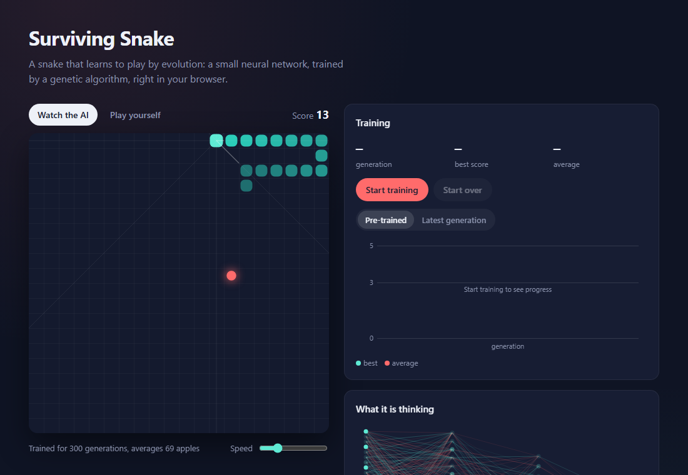

# Surviving Snake

A snake that learns to play by evolution. A small neural network decides
each move, and a genetic algorithm trains it, all in plain JavaScript in the
browser, with no libraries.



You can watch a pre-trained snake, train your own from scratch and watch the
scores climb, or play yourself.

## How it works

**What it sees** ([`src/sensors.js`](src/sensors.js)). From its head the snake
looks in eight directions. For each one it gets three numbers: how close the
wall is, how close its own body is, and whether food lies that way. Its
heading and the direction its tail is moving add eight more, for 32 inputs.

**How it decides** ([`src/brain.js`](src/brain.js)). The inputs go through a
fully connected network with two hidden layers (32 → 20 → 12 → 4, ReLU). The
four outputs are up, right, down and left; the snake follows the strongest.
All 964 weights live in one flat array, which is what evolution works on.

**How it learns** ([`src/evolution.js`](src/evolution.js)). 400 snakes with
random weights each play a game, all with the same food sequence so the
comparison is fair. Fitness is `steps + 1000 × apples²`: eating dominates,
and surviving only matters until the first apple. A snake starves after 200
moves without food, so circling forever does not pay. The best 5% carry over
unchanged. The rest of the next generation are children of two parents picked
by tournament (best of five random snakes); each weight comes from one parent
or the other, and 5% of weights get a random nudge.

Training runs in a web worker ([`src/worker.js`](src/worker.js)), so the page
stays smooth while a generation plays out.

## Results

With the settings above and seed 1, the first ~150 generations barely eat. Then
the snakes learn to head for food and things take off:

| Generation | Best score | Average score |
|---:|---:|---:|
| 100 | 2 | 0.1 |
| 200 | 44 | 10.0 |
| 300 | 78 | 34.6 |

The pre-trained brain in [`brains/trained.json`](brains/trained.json) is the
one from generation 300 that did best over 20 new games: 69 apples on average.
Over 100 further games it ran into its own body 67 times, hit a wall 32 times
and starved once. It only sees in straight lines, so it cannot plan a way
around its own tail; that is the obvious next thing to improve.

## Running it

It is a static page with ES modules, so it needs to be served over HTTP:

```sh
npx serve .        # or: python -m http.server
```

Then open the address it prints.

Tests and training run on Node.js 18 or newer:

```sh
npm test                    # game rules, sensors, network, evolution
npm run train -- 300 1      # generations, seed; writes brains/trained.json
```
